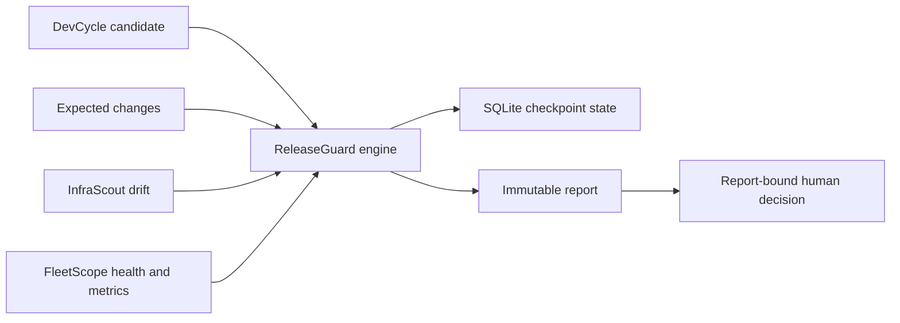

# ReleaseGuard

AI DevOps Open Suite 的发布验证与证据模块。它把一份可评审 JSON 计划执行成确定性门禁、不可变报告、回滚步骤和独立人工批准记录。

[](https://github.com/GeneJie199/release-validation/actions/workflows/ci.yml)
[](LICENSE)

## Screenshot


## Why

Release decisions should be repeatable and reviewable, not a collection of screenshots and remembered commands. ReleaseGuard turns a versioned plan into deterministic checks, expected-change coverage, an observation window, rollback evidence, and a report-bound human decision.

## Core Features

- `command` / `playwright`：运行本地测试、构建、lint 或浏览器命令。
- `http`：校验方法、状态码、响应文本和请求头。
- `file`：校验文件存在、最小大小和 SHA-256。
- `json`：按简单字段路径检查 JSON 值。
- `sql`：在只读事务中使用环境 DSN 运行 PostgreSQL/MySQL 查询；默认只记录列名和行数，显式设置 `include_sql_preview` 才记录最多 20 行值。
- `env` / `compose`：比较配置结构，只在报告中记录键名，不泄露值。
- DevCycle 发布候选重新验真：readiness、任务、标准和证据覆盖。
- Git base/target 清单、提交、迁移/配置文件和未声明敏感改动。
- 版本化 Expected Changes：与发布 ID、版本及文档 SHA-256 绑定，精确关联 InfraScout、数据库、Fleet 和拓扑实际变化。
- 变化声明可关联验证项、指标策略和受影响节点；缺失、歧义、拒绝项与额外变化都会保留结构化证据并阻断。
- FleetScope 节点版本、健康、新鲜度、严重告警和持续观察采样。
- FleetScope 原生时序查询、发布前基线和发布后指标回归阈值。
- SQLite 运行检查点、中断恢复、历史运行列表和 Viewer 实时刷新。
- `GO` / `HOLD` / `NO-GO` 决策、不可变报告、回滚清单和绑定报告哈希的人工批准。
- 强制 `recovery_checks` 验证旧制品、备份、恢复端点或回滚脚本等回滚前提；只有说明文字不能得到 `GO`。
- 人工决策只能维持或收紧自动结论，不能把 `HOLD` / `NO-GO` 覆盖成 `GO`；活跃验证期间禁止绑定旧报告。
- 响应式中文决策台；默认只读，可用独立 Bearer Token 启用一次性不可变 Web 批准，无 Node/CDN 运行依赖。
- 阶段轨迹、变化覆盖、证据关联和可执行修复建议；最终批准始终只属于人。

## Quick Start

```bash
go build -trimpath -o releaseguard ./cmd/releaseguard
./releaseguard init --repository . --version 1.4.0
./releaseguard check --plan release-plan.json --state releaseguard-runs.db --out release-report.json
./releaseguard runs --state releaseguard-runs.db
./releaseguard confirm --report release-report.json --decision GO --by "$USER" --note "reviewed"
./releaseguard serve --report release-report.json --state releaseguard-runs.db --addr 127.0.0.1:8771 --open
./releaseguard doctor --report release-report.json --state releaseguard-runs.db --url http://127.0.0.1:8771
```

打开 `http://127.0.0.1:8771/`。报告页面包含结论、门禁证据、Git 变更、Fleet 目标节点、回滚步骤和批准记录。

需要在本机页面写入最终人工决策时，为服务配置一个短期 Token：

```bash
export RELEASEGUARD_APPROVAL_TOKEN='replace-with-a-long-random-token'
./releaseguard serve --report release-report.json --addr 127.0.0.1:8771
```

页面写入与 `confirm` 生成同一种 SHA-256 绑定批准文件；已存在的批准仍会返回冲突，不能覆盖。Token 至少 24 字符，只存在服务进程和当前浏览器表单中，不写入报告。自动验证仍在运行时，批准接口会被硬性关闭。

报告和批准默认不可覆盖。重复演示时删除旧输出，或仅对明确的临时路径使用 `check --force`。

## Online Install

Install and start the complete Open Suite, including ReleaseGuard:

```bash
curl -fsSL https://raw.githubusercontent.com/GeneJie199/ai-devops-open-suite/main/scripts/bootstrap.sh | bash
```

```powershell
irm https://raw.githubusercontent.com/GeneJie199/ai-devops-open-suite/main/scripts/bootstrap.ps1 | iex
```

For ReleaseGuard alone, download the matching archive and `checksums.txt` from [Releases](https://github.com/GeneJie199/release-validation/releases/latest), extract them, then use the packaged installer.

## Offline Install

On an online machine, download the matching `releaseguard-<version>-<os>-<arch>` archive and `checksums.txt`, then move both files to the offline machine and extract the archive:

```bash
sudo sh scripts/install.sh install ./releaseguard ./checksums.txt
sudo sh scripts/install.sh doctor
```

```powershell
.\scripts\install.ps1 -Action Install -Source .\releaseguard.exe -Checksums .\checksums.txt
.\scripts\install.ps1 -Action Doctor
```

The Open Suite full offline bundle includes ReleaseGuard, the other products, protocol schemas, manifests, checksums, and all installation metadata. Installation from that bundle performs no public network access.

## First Five Minutes

1. Run `releaseguard init --repository . --version VERSION` in the project to be released.
2. Review `release-plan.json`, especially required checks, expected changes, observation rules, and recovery checks.
3. Run `releaseguard check` and open the local decision console.
4. Resolve every required failure and rerun the same stateful plan; interrupted observation resumes from its checkpoint.
5. Record `GO`, `HOLD`, or `NO-GO` only after reviewing the report and rollback evidence.

## AI Optional

ReleaseGuard needs no AI provider. Every decision, check, correlation, and recommendation is produced from deterministic evidence. Its structured report can be passed to an external AI for explanation, but AI output is never accepted as a check result and cannot approve or execute a deployment.

## Comparison

| Tool category | Primary strength | ReleaseGuard's role |
|---|---|---|
| CI systems | Build and test automation | Bind verified CI-style checks to one release intent and immutable report |
| Deployment tools | Apply infrastructure or application changes | Validate before and after deployment without deploying or switching traffic |
| Approval systems | Organizational workflow and identity | Produce evidence and a report-bound decision artifact; it does not replace enterprise IAM |
| Monitoring dashboards | Live operational visibility | Query FleetScope during a bounded release observation window and measure regression |

## Architecture



ReleaseGuard does not import another product's code or read its private database. Inputs are versioned files and documented HTTP APIs; execution checkpoints are local SQLite state, while final reports and approvals are immutable JSON artifacts.

## Security

- The Viewer binds to loopback by default and is read-only unless a temporary environment-only approval token is supplied.
- Command checks are an explicit trusted-local-code boundary; HTTP, Git, file, JSON, SQL, and configuration checks use bounded parsers and clients.
- SQL is restricted to read-only query forms and credentials come from named environment variables.
- Reports redact configuration values and never persist Fleet tokens or database DSNs.
- Releases include SHA-256 checksums, CycloneDX SBOM, secret scanning, fuzz checks, and GitHub provenance.

See [SECURITY.md](SECURITY.md) and [docs/operations.md](docs/operations.md).

## Roadmap

The v1.0 boundary is deterministic release validation and evidence, not deployment automation. Policy packs, more observation adapters, and deeper external approval integrations remain on the [Open Suite roadmap](https://github.com/GeneJie199/ai-devops-open-suite/blob/main/ROADMAP.md).

## Contributing

Read [CONTRIBUTING.md](CONTRIBUTING.md). New check types require deterministic fixtures, timeout and redaction behavior, malformed-input coverage, resume semantics where applicable, and a documented evidence boundary.

## Product Reference

## 发布计划

仓库根目录的 [release-plan.example.json](release-plan.example.json) 可直接运行。包含所有集成字段的参考见 [examples/full-release-plan.json](examples/full-release-plan.json)。

`releaseguard init` 会从 Git 仓库、当前版本和最近标签生成一份不可覆盖的起步计划，并按 Go、Node 或通用仓库选择第一条检查。它不会自动把真实变化批准成“预期变化”；生产发布仍应提交经过评审的 [Expected Changes 示例](examples/expected-changes.example.json)。

```json
{
  "release_id": "orders-api-2026-08-12",
  "version": "1.4.0",
  "recovery_checks": [
    {"name": "previous artifact", "type": "file", "path": "dist/service-1.3.0"}
  ],
  "checks": [
    {"name": "tests", "type": "command", "command": "go test ./..."},
    {"name": "health", "type": "http", "url": "https://service/health", "want_status": 200}
  ],
  "rollback": ["Restore the previous reviewed binary", "Verify health before reopening traffic"]
}
```

每个 check 默认是 required；设置 `"required": false` 可把失败降为 `HOLD`。任何 required 失败都会得到 `NO-GO`。

## Expected Changes

Expected Changes 是发布意图与发布后事实之间的版本化合同：

```json
{
  "spec": "lifecycle-spec/expected-changes/v1",
  "kind": "expected-changes",
  "release_id": "orders-api-2026-08-12",
  "version": "1.4.0",
  "generated_at": "2026-08-12T08:00:00Z",
  "changes": [{
    "id": "orders-total-column",
    "source": "database",
    "action": "added",
    "resource_id": "dbmeta:column:public.orders.total_cents",
    "resource_type": "database.column",
    "summary": "Add the reviewed total_cents column",
    "verification_checks": ["database smoke"]
  }]
}
```

`source` 支持 `infrascout`、`database`、`fleet` 和 `topology`；`action` 支持 `added`、`removed` 和 `changed`。匹配使用稳定资源 ID，可选收紧资源类型、节点、字段和指纹。数据库声明必须关联计划中的验证项；Fleet/拓扑声明必须给出 `node_id` 或 `affected_nodes`。Git 中出现迁移文件但没有数据库声明时会直接阻断。旧的 `expected_drifts` 仍可读取，但新计划应使用 `expected_changes_file`。

`recovery_checks` 至少一项且全部是必须门禁，用于证明回滚所依赖的旧制品、备份、恢复连接或操作脚本真实可用。`rollback` 保留人工执行顺序，两者缺一不可。命令检查可用 `working_directory` 固定执行目录；配置仓库后未显式填写时默认在仓库根目录运行。

## 跨模块链路

DevCycle：

```bash
devcycle requirement export --id REQ_ID --out release-candidate.json
```

InfraScout：

```bash
infrascout check --state-dir /var/lib/infrascout --fail-on never
```

ReleaseGuard 计划引用 `candidate_file`、`drift_file` 和 `fleet` 后，会生成同一份发布 Manifest。Fleet observation 会重复轮询而不是只采一张瞬时快照。`metrics` 策略直接查询 FleetScope 内置时序库，比较发布前基线和整个发布后窗口；Prometheus 等仅是 FleetScope 的兼容输入，不是 ReleaseGuard 运行依赖。

观察期间每个样本都会写入 SQLite。活动 run 使用短期租约保证同一时刻只有一个进程执行门禁；正常中断立即释放，崩溃后的租约会自动过期。以相同计划和 `--state` 再次运行 `check` 会恢复同一个 run，只执行剩余观察窗口，不重复命令门禁或基线采集。`releaseguard runs` 可查看 run ID、阶段、样本数和最终决策。

确定不再恢复的中断运行可用 `releaseguard runs --state releaseguard-runs.db --abandon RUN_ID --reason "change window closed"` 审计式关闭。工具对可恢复中断返回退出码 `3`，参数错误仍使用 `2`。

## 人工批准

```bash
releaseguard confirm \
  --report release-report.json \
  --decision GO \
  --by release-manager \
  --note "change window approved"
```

输出默认为 `release-report.json.approval.json`，包含批准人、时间、决策和报告 SHA-256。工具的 `GO` 不等于自动上线；批准文件保持人的最终责任边界。

## 安全模型细节

- 计划中的 `command` 会执行 shell，必须像部署脚本一样评审。
- `git-ref` 检查直接调用 Git 参数接口，不经过 shell，适合作为默认回滚制品前提。
- SQL DSN 和 Fleet Token 只从计划指定的环境变量读取。
- SQL 检查仅接受单条只读 `SELECT`、`SHOW` 或 `WITH` 语句，并仍应使用无写权限账户。
- `.env` / Compose 对比不记录配置值，只记录新增、删除、变化和未声明键。
- Viewer 默认拒绝非 loopback 地址；远程查看优先使用 SSH 隧道。
- Viewer 默认只读；仅通过进程环境变量 `RELEASEGUARD_APPROVAL_TOKEN` 配置临时 Token 后接受带 Bearer Token 的一次性批准写入，避免 Token 出现在进程参数中。HTTP 永不执行计划命令，也不能覆盖已有批准。

## 安装与运维

```bash
sudo sh ./scripts/install.sh install ./releaseguard ./checksums.txt
sudo sh ./scripts/install.sh doctor
sudo sh ./scripts/install.sh uninstall
```

Windows 当前用户安装：

```powershell
powershell -ExecutionPolicy Bypass -File .\scripts\install.ps1 -Action Install -Source .\releaseguard.exe -Checksums .\checksums.txt
```

卸载默认保留报告、运行记录和批准。`purge` 需要提供精确数据目录确认，避免误删审计证据。

退出码、systemd 报告服务、最小权限和证据说明见 [docs/operations.md](docs/operations.md)。

## 边界

- ReleaseGuard 不部署二进制、不切流量、不执行回滚，也不替代审批系统。
- `playwright` 类型复用本机已安装的命令，不内置浏览器运行时。
- 文件/命令/HTTP 证据证明计划检查结果，不证明计划之外的业务正确性。

Apache-2.0。贡献流程见 [CONTRIBUTING.md](CONTRIBUTING.md)，安全问题见 [SECURITY.md](SECURITY.md)。
